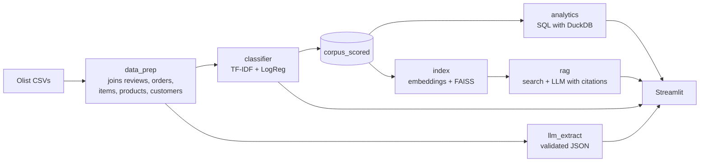

# What Olist customers complain about

<!-- after deploying to Streamlit Cloud, add the app link here -->

Review classification, structured extraction with an LLM, and natural-language questions (RAG) over the
~100k reviews in the
[Brazilian E-Commerce Public Dataset by Olist](https://www.kaggle.com/datasets/olistbr/brazilian-ecommerce).

Companies receive thousands of reviews and rarely read them all. The goal is to automatically find out
what is going wrong, how often, and point to the reviews that back up each conclusion. The system has
three parts:

1. **Classification** of each review (sentiment, complaint category, severity) with TF-IDF + logistic
   regression and with an LLM, compared on the same annotated set.
2. **Dashboard** with the negative-review rate by category, main causes, the effect of delivery delays
   and trends over time. Every number is computed in SQL; none is estimated by the LLM.
3. **Natural-language questions** ("what are the delivery problems with electronics?"), answered with a
   summary that cites every review used as evidence.

The reviews, and therefore the app interface, are in Brazilian Portuguese.


---

## How to run

Python 3.10+. On Windows, use `.venv\Scripts\activate` instead of `source .venv/bin/activate`.

```bash
python -m venv .venv
source .venv/bin/activate
pip install -r requirements.txt

python run_pipeline.py          # downloads the data, processes, trains, indexes and evaluates
streamlit run streamlit_app.py
```

`run_pipeline.py` runs every step that does not need an LLM. The slowest one is indexing: on the first
run, Sentence Transformers downloads the model (~470 MB) and encodes 42k texts, which takes a few minutes
on CPU. Everything else runs in under a minute.

The LLM steps require an API key. Copy `.env.example` to `.env` and fill in one of the options:
Anthropic, or any OpenAI-compatible API (including a local Ollama). Then:

```bash
python run_pipeline.py --llm
```

This runs the structured extraction on the 400 annotated reviews, the 12 RAG test questions (scored by
an LLM judge) and the comparison with the human review of the gold set, then updates
`reports/resultados.md` and the results table in this README. With Haiku 5.5, the extraction takes about
15 minutes and the RAG evaluation about 4. Calls are cached, so re-runs cost nothing. Ideally the RAG
judge is a different model from the generator (`JUDGE_MODEL` in `.env`).

Without a key the app still works: the questions page shows an automatic summary instead of the LLM
answer, and the TF-IDF vs. LLM comparison is disabled.

Tests: `pip install -r requirements-dev.txt && pytest`.

---

## Project structure



```
├── streamlit_app.py        app entry point
├── run_pipeline.py         runs the steps in order (--llm for the LLM steps)
├── app/                    Streamlit pages (dashboard, classify, ask, metrics, review)
├── src/
│   ├── data_prep.py        step 1: cleaning, joins, delivery delay, order category
│   ├── rules.py            keyword rules (weak supervision) and severity
│   ├── classifier.py       step 2A: TF-IDF + logistic regression
│   ├── llm.py              LLM client (Anthropic or OpenAI-compatible) with caching
│   ├── llm_extract.py      step 2B: prompt, parsing and JSON validation
│   ├── embeddings.py       Sentence Transformers, with LSA as an offline fallback
│   ├── index.py            FAISS index
│   ├── rag.py              step 3: filters, search, computed numbers, prompt with citations
│   ├── analytics.py        dashboard SQL
│   ├── eval_llm.py         per-field precision/recall
│   ├── eval_search.py      Recall@K
│   ├── eval_rag.py         faithfulness and relevance
│   ├── eval_gold.py        agreement between the human review and the first pass
│   ├── usage.py            LLM call limits for the public app
│   └── report.py           generates reports/resultados.md
├── data/annotations/       the 400 annotated reviews (gold) and the first pass
├── data/eval/              RAG test questions
├── notebooks/01_eda.ipynb  exploratory analysis
├── reports/                metrics (json + md) and figures
└── docs/anotacao.md        annotation guidelines (Portuguese)
```

---

## Key findings

Details in the [EDA notebook](notebooks/01_eda.ipynb).

**Delivery delays are strongly associated with negative reviews.** Orders delivered on time get a
negative review (1 or 2 stars) in ~9% of cases. With a 1 to 3 day delay, 32%; beyond a week, ~80%,
practically the same as not receiving the product at all (78%). The months with the most delays
(purchases from Nov 2017, Black Friday, and Feb–Mar 2018) match the peaks in dissatisfaction.


**Delivery estimates are conservative.** ~72% of reviewed orders arrive more than a week before the
promised date; the median is 12 days early. Actual delays are rare (6.7%), but their impact is large.

**Orders with more than one seller get far more complaints.** These orders arrive in separate packages
and have 47% negative reviews, against 14% for single-seller orders. There are few of them (~1,300), and
the pattern shows up in the text: "I bought 2 and only 1 arrived".

**Where the customer lives matters more than what they bought.** Across product categories, the negative
rate varies little (10% to 16%). Across states it varies a lot: SP and PR sit at ~12.5%, while Alagoas and
Maranhão exceed 21% and are also the states with the most delays.

**A 3-star rating is not a good "neutral" label.** In the reference set, more than half of the 3-star
reviews are complaints when you read the text. Treating 3 stars as neutral produces bad labels and
explains part of the weak performance on the neutral class.

Two quirks of the dataset: ~800 reviews are duplicated across different orders, and Olist anonymized store
names by replacing them with Game of Thrones houses ("comprei nas lojas lannister"). Preprocessing replaces
these names with "loja" (store).

---

## Evaluation

Every method is measured on the same reference set.

### Reference set (gold)

400 reviews with text, sampled with stratification by star rating and with **more negative reviews**
than the real distribution (120 with 1 star, 50 with 2, 70 with 3, 60 with 4 and 100 with 5). A simple
random sample would contain ~145 complaints, and `wrong_product` and `missing_items` would have about 20
examples each. With stratification there are 233 reviews with a complaint. As a consequence, gold-set
metrics are meant for comparing methods, not for estimating real-world rates.

Each review has a sentiment (read from the text, not the rating), complaint categories, severity, the
aspects mentioned, a verbatim evidence span and a short description of the problem. The guidelines are in
[`docs/anotacao.md`](docs/anotacao.md).

The first annotation pass was LLM-assisted, using only the review text, and is preserved in
`data/annotations/gold_400_primeira_passada.csv`. Since the LLM evaluated in step 2B could share biases
with the one that assisted the annotation, 100 reviews were manually re-annotated in **blind mode**
(without access to the first-pass labels), in a fixed random order. `src/eval_gold.py` measures the
agreement between the two passes and recomputes the metrics on the human-reviewed rows only.

| Key | Description | In gold |
|---|---|--:|
| `delivery` | late, not received, lost in transit | 96 |
| `product_quality` | defective, broken, poor quality, counterfeit | 66 |
| `customer_service` | no response, exchange, refund, cancellation | 49 |
| `wrong_product` | wrong item or different from the listing | 38 |
| `missing_items` | incomplete order, missing item | 34 |

### Results

Generated by `python -m src.report` from `reports/metrics.json`. The full version (per category, per
field) is in [`reports/resultados.md`](reports/resultados.md) and on the app's metrics page.

<!-- resultados:inicio -->
| Macro-F1 on gold (n=400) | Star rating only | Keyword rules | TF-IDF + LogReg | LLM |
|:--|--:|--:|--:|--:|
| Sentiment | 0.70 | — | 0.75 | 0.84 |
| Complaint category | — | 0.70 | 0.69 | 0.90 |
| Severity | — | — | 0.56 | 0.79 |

**Human review of the gold set:** 100 of 400 reviewed, 100 in blind mode (without seeing the first-pass labels).

| Agreement: blind review vs. first pass | Result |
|:--|--:|
| Sentiment (Cohen's kappa) | 0.82 |
| Severity (weighted kappa) | 0.84 |
| Categories: identical set | 88% |
| Rows with any change | 39 of 100 |

Macro-F1 on the 100 human-reviewed rows only:

| Method | Sentiment | Categories | Severity |
|:--|--:|--:|--:|
| Star rating only | 0.69 | — | — |
| Keyword rules | — | 0.76 | — |
| TF-IDF + LogReg | 0.77 | 0.76 | 0.55 |
| LLM | 0.84 | 0.87 | 0.60 |

**Search** (15 queries, relevance given by the annotated category):

| Method | Recall@20 | Recall@50 | Recall@100 | P@10 |
|:--|--:|--:|--:|--:|
| TF-IDF (keyword) | 0.14 | 0.27 | 0.41 | 0.48 |
| LSA (TF-IDF + SVD) | 0.20 | 0.34 | 0.55 | 0.55 |
| Sentence Transformers (paraphrase-multilingual-MiniLM-L12-v2) | 0.19 | 0.38 | 0.56 | 0.59 |
| Random (baseline) | 0.05 | 0.12 | 0.25 | 0.14 |

**Search index shipped in the repository:** Sentence Transformers (`sentence-transformers/paraphrase-multilingual-MiniLM-L12-v2`).

**RAG:**

12 questions · generator `claude-haiku-5-5` · judge `claude-haiku-5-5` · embeddings `sentence-transformers/paraphrase-multilingual-MiniLM-L12-v2`

| Metric | Result |
|:--|--:|
| Faithfulness (claims supported by the cited reviews) | 0.85 |
| Context relevance (retrieved reviews related to the question) | 0.79 |
| Answer relevance (1 to 5) | 3.50 |
| Answer segments with a citation | 0.42 |
| Answers with a number not computed in Python | 0 of 12 |
<!-- resultados:fim -->

### Interpretation

The comparisons below mostly use the 100 reviews re-annotated in blind mode, whose labels do not depend on
the first pass.

**The LLM beats TF-IDF on every task, by a wide margin on categories.** On the human-reviewed rows, Haiku
5.5 reaches 0.87 macro-F1 on categories, against 0.76 for TF-IDF and 0.76 for the keyword rules; on
sentiment, 0.84 against 0.77. No training, just a prompt with two examples. 99.9% of the evidence spans it
returns are verbatim excerpts of the review, which makes every answer checkable.

**TF-IDF does not beat the rules that produced its labels.** The dataset has no complaint-category
labels, so the approach is weak supervision: keyword rules (`src/rules.py`) label the 42k reviews and the
logistic regression is trained on those labels. The model did not generalize beyond the rules (0.76 vs.
0.76 on the reviewed rows) and inherited their gaps. The worst case is `wrong_product`, with low recall (see
`reports/resultados.md`), because there are many ways of saying "this is not what I ordered". The category
rules were written before the gold-set evaluation and were not tuned on its errors, so as not to inflate
the results. Improving TF-IDF requires more labels, not more rules.

**For sentiment, a model trained on star ratings describes the text better than the rating itself**
(0.77 vs. 0.69 on the reviewed rows). The difference comes from 3-star reviews: with the first-pass labels,
the model gets the sentiment of the text right for 53% of 3-star reviews, against 20% for simply mapping
"3 stars = neutral". It learns what complaint text looks like from 1- and 2-star reviews and recognizes it
even when the rating is 3.

**On severity, the blind review changed the result.** Against all 400 labels, most still from the first
pass, the LLM scores 0.79 on severity; on the 100 human-reviewed rows, 0.60, close to TF-IDF (0.55).
Sentiment and categories barely move (0.84 and 0.84; 0.90 and 0.87). Part of the gap may be noise (100
reviews, few in the `low` class), but the direction points to bias shared between the evaluated LLM and the
one that assisted the first annotation, precisely on the most subjective criterion. The reviewed-rows figure
is the reliable one for severity.

**RAG: the answers hold up; retrieval does not always.** Across the 12 test questions, on average 85% of
the claims are supported by the cited reviews and 79% of the retrieved reviews are related to the question.
The weak spots are two questions with the same cause: after the filters are extracted, little of the
question is left for the search. In the furniture question, the search receives only "chega" (arrives) and
1 of the 8 retrieved reviews is relevant; in the toys and baby products question, only "reclamam"
(complain), with 3 of 8. On average, 42% of the answer segments carry a citation. The judge is the same
model that generates the answers, which tends to make faithfulness optimistic.

**Search: Sentence Transformers has the best precision at the top** (P@10 of 0.59, against 0.55 for LSA
and 0.48 for keyword search). The 15 test queries use varied wording ("a encomenda sumiu no caminho", the
package got lost on the way, instead of "atraso", delay), which is where keyword search falls short.

---

## Example: asking the RAG

A question about delivery problems with electronics. The answer cites every review it uses, relies only
on numbers computed in Python, and says when a retrieved review is off-topic.


---

## Technical decisions

**Numbers come from Python, never from the LLM.** In the RAG, the prompt receives a block of numbers
computed with pandas over the whole slice (in the electronics example, the 6,561 reviews with text in that
category, not just the 8 retrieved ones) and forbids any other number. The RAG evaluation checks this
automatically by looking for numbers in the answer that did not come from that block (normalizing the
Brazilian thousands separator and decimal comma: "3.917" = 3917). Retrieved reviews are evidence, not
statistics.

**Question preprocessing.** Terms that imply a filter become filters ("eletrônicos" becomes a product
category, "problemas" becomes rating ≤ 3) and the question framing ("quais são os principais problemas
relacionados a...", what are the main problems related to...) is removed before searching. Otherwise
generic words such as "produtos" (products) dominate the similarity. The filters are shown pre-filled in
the interface and can be adjusted.

**Rates without the rating filter.** The rates sent to the LLM use the slice without the "rating ≤ 3"
filter; with it, the share of negative reviews would be inflated by the filter itself (75% instead of 27%
for electronics). Only the category breakdown uses the reviews with a problem.

**Recall@K by category.** Relevance is defined by the annotated category in the gold set, with a random
baseline in the table for scale. A known-item test (retrieving the original review from the description of
its problem) is not informative on this dataset: there are thousands of near-identical reviews ("não recebi
o produto", I did not receive the product), and any of them is a correct answer.

**8-bit quantized FAISS index.** The index is 4x smaller (~16 MB with MiniLM instead of ~65 MB), which makes
it easier to version on GitHub and deploy on Streamlit Cloud. On the 15 test queries, 98% of the top-10
matches an exact index (`IndexFlatIP`); in the worst case, 8 out of 10.

**LSA as an offline fallback.** If Sentence Transformers cannot be loaded (no internet or no torch), the
index is built with TF-IDF + SVD and the app shows which one is in use. LSA also serves as a baseline in the
search evaluation.

**Responses truncated by the model's reasoning.** Haiku 5.5 uses adaptive thinking by default, and those
tokens count toward `max_tokens`. With low limits, the response can end before the JSON closes. The client
detects `stop_reason == "max_tokens"` and retries with a higher limit; truncated responses already in the
cache are redone when read.

**LLM output is always validated.** Every response goes through `validate()`: categories outside the list
are dropped, an invalid severity falls back to a default, and every evidence span is checked against the
original text. Calls are cached on disk.

**Usage limits on the public app.** LLM calls are capped per session and per day (`LLM_SESSION_LIMIT`,
`LLM_DAILY_LIMIT`). When the limit or the API credit runs out, the app keeps working without the LLM (the
questions page falls back to the automatic summary).

---

## Limitations

- The gold set has 400 reviews and is skewed toward negative ones. Differences of 0.01–0.02 F1 between
  methods are within noise.
- The measured agreement is between one person and the LLM first pass, not between two human annotators.
  Categories such as `customer_service` have debatable boundaries.
- The RAG judge is the same model that generates the answers (Haiku 5.5). A larger judge, via
  `JUDGE_MODEL`, would give a more reliable faithfulness score at a higher cost.
- The complaint categories on the dashboard come from the TF-IDF classifier and carry its error. The
  dashboard says so.
- The data covers 2016 to 2018 and does not describe Olist today.
- The review page writes directly to the CSV; it works locally, but on Streamlit Cloud the disk is
  ephemeral.
- On Streamlit Cloud, torch and the embedding model take up much of the memory. If the app runs out of
  memory, the index can be built with `python -m src.index --backend lsa`; the app uses whatever backend is
  saved next to the index (`artifacts/index/embedder.json`).

## Deployment

Streamlit Cloud does not run the pipeline, so the generated files (`data/processed/reviews.parquet`,
`data/processed/corpus_scored.parquet` and `artifacts/`, ~50 MB) are part of the repository.

1. Create the app on [share.streamlit.io](https://share.streamlit.io) pointing to `streamlit_app.py`.
2. Under *Secrets*, in TOML format:

   ```toml
   ANTHROPIC_API_KEY = "..."
   LLM_SESSION_LIMIT = "10"   # LLM calls per visitor
   LLM_DAILY_LIMIT = "200"    # LLM calls per day, across all visitors
   ```

Streamlit exposes these values as environment variables, which is where the code reads them from. The
app-level limits reset when the app restarts; for cost control, also set a spending limit in the provider's
console.

## Next steps

- Re-annotate ~300 more reviews and use the current gold set for training as well, not just testing.
- Use the LLM to label the 42k reviews once and train TF-IDF on those labels: cheap inference in
  production with part of the LLM's quality.
- Hybrid search (BM25 + embeddings), useful when the query contains rare terms.
- Rewrite the question with the LLM before searching, for cases where little text is left after the filters
  are extracted (like "chega" in the furniture question).
- Use a larger model as the RAG judge.

## A personal note

This project was a lot of fun to build, and it was my first time really getting my hands dirty with LLMs:
not just calling an API, but writing and validating prompts, dealing with truncated responses, building a
RAG that has to cite its sources, and above all measuring whether any of it actually works. Doing the blind
review of 100 reviews myself and watching the LLM's severity score drop from 0.79 to 0.60 was the moment
evaluation really clicked for me. Feedback and suggestions are very welcome!

---

Data: Olist, [CC BY-NC-SA 4.0](https://creativecommons.org/licenses/by-nc-sa/4.0/). The files are the same
as on Kaggle; the download script uses
[Olist's public GitHub repository](https://github.com/olist/work-at-olist-data), which requires no login.
Code under the MIT license.