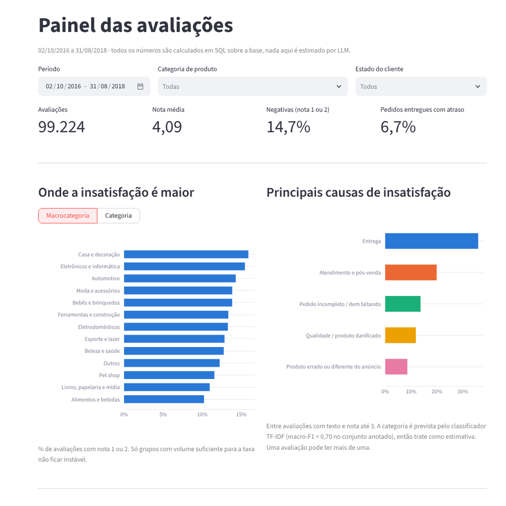
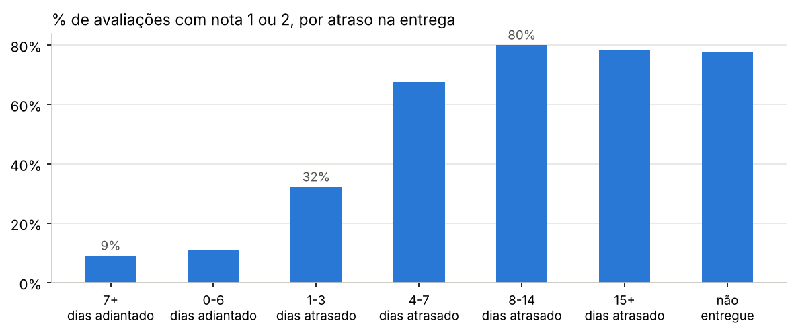
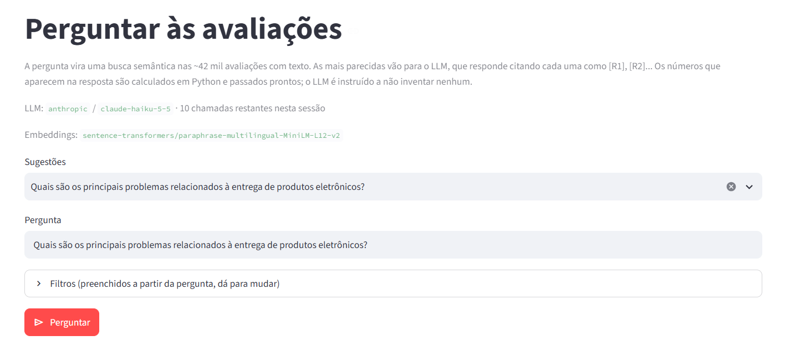
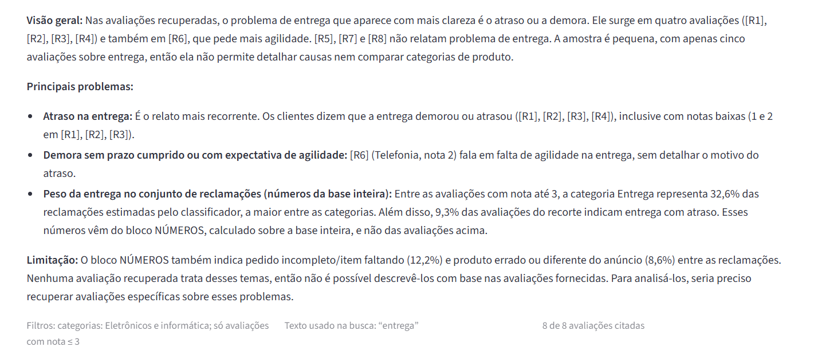
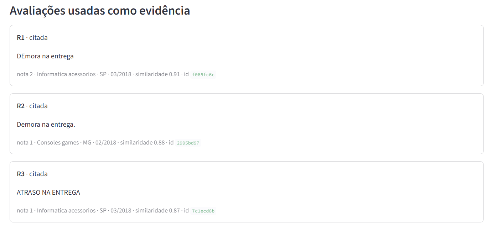
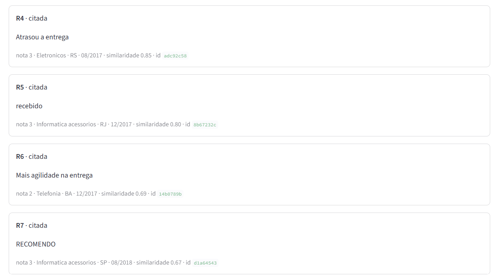
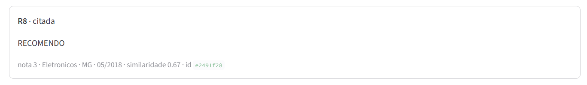

# O que os clientes da Olist reclamam

<!-- depois do deploy no Streamlit Cloud, colocar o link do app aqui -->

Classificação de avaliações, extração estruturada com LLM e perguntas em linguagem natural (RAG)
sobre as ~100 mil avaliações do
[Brazilian E-Commerce Public Dataset by Olist](https://www.kaggle.com/datasets/olistbr/brazilian-ecommerce).

Empresas recebem milhares de avaliações e raramente conseguem ler todas. O objetivo é identificar
automaticamente o que está dando errado, com que frequência, e apontar as avaliações que sustentam
cada conclusão. O sistema tem três partes:

1. **Classificação** de cada avaliação (sentimento, categoria da reclamação, severidade) com TF-IDF +
   regressão logística e com um LLM, comparados no mesmo conjunto anotado.
2. **Painel** com taxa de avaliações negativas por categoria, principais causas, efeito do atraso e
   evolução no tempo. Os indicadores são calculados em SQL; nenhum é estimado por LLM.
3. **Perguntas em linguagem natural** ("quais os problemas de entrega em eletrônicos?"), respondidas
   com um resumo que cita cada avaliação usada como evidência.



---

## Como rodar

Python 3.10+. No Windows, use `.venv\Scripts\activate` no lugar de `source .venv/bin/activate`.

```bash
python -m venv .venv
source .venv/bin/activate
pip install -r requirements.txt

python run_pipeline.py          # baixa os dados, processa, treina, indexa e avalia
streamlit run streamlit_app.py
```

`run_pipeline.py` executa todas as etapas que não dependem de LLM. A mais lenta é a indexação: na
primeira execução, o Sentence Transformers baixa o modelo (~470 MB) e codifica 42 mil textos, o que
leva alguns minutos em CPU. As demais etapas rodam em menos de um minuto.

As etapas com LLM exigem uma chave de API. Copie `.env.example` para `.env` e preencha uma das
opções: Anthropic ou qualquer API compatível com OpenAI (inclusive Ollama local). Em seguida:

```bash
python run_pipeline.py --llm
```

Esse comando executa a extração estruturada nas 400 avaliações anotadas, as 12 perguntas de teste do
RAG (avaliadas por um LLM juiz) e a comparação com a revisão humana do gold, e atualiza
`reports/resultados.md` e a tabela de resultados deste README. Com o Haiku 5.5, a extração leva cerca
de 15 minutos e a avaliação do RAG cerca de 4. As chamadas ficam em cache, então execuções repetidas
não geram custo. Para o juiz do RAG, o ideal é um modelo diferente do gerador (`JUDGE_MODEL` no `.env`).

Sem chave, o app continua funcionando: a página de perguntas mostra um resumo automático no lugar da
resposta do LLM, e a comparação TF-IDF x LLM fica desativada.

Testes: `pip install -r requirements-dev.txt && pytest`.

---

## Estrutura


```
├── streamlit_app.py        entrada do app
├── run_pipeline.py         executa as etapas em ordem (--llm para as que usam LLM)
├── app/                    páginas do Streamlit (painel, classificar, perguntar, métricas, revisar)
├── src/
│   ├── data_prep.py        etapa 1: limpeza, junção, atraso, categoria do pedido
│   ├── rules.py            regras de palavra-chave (supervisão fraca) e severidade
│   ├── classifier.py       etapa 2A: TF-IDF + regressão logística
│   ├── llm.py              cliente de LLM (Anthropic ou compatível com OpenAI) com cache
│   ├── llm_extract.py      etapa 2B: prompt, parsing e validação do JSON
│   ├── embeddings.py       Sentence Transformers, com LSA como alternativa offline
│   ├── index.py            índice FAISS
│   ├── rag.py              etapa 3: filtros, busca, números, prompt com citações
│   ├── analytics.py        SQL do painel
│   ├── eval_llm.py         precision/recall por campo
│   ├── eval_search.py      Recall@K
│   ├── eval_rag.py         faithfulness e relevância
│   ├── eval_gold.py        concordância da revisão humana com a primeira passada
│   ├── usage.py            limites de chamadas ao LLM no app público
│   └── report.py           gera reports/resultados.md
├── data/annotations/       as 400 avaliações anotadas (gold) e a primeira passada
├── data/eval/              perguntas de teste do RAG
├── notebooks/01_eda.ipynb  análise exploratória
├── reports/                métricas (json + md) e figuras
└── docs/anotacao.md        critério de anotação
```

---

## Principais achados

Detalhes no [notebook de EDA](notebooks/01_eda.ipynb).

**Atraso na entrega está fortemente associado a avaliações negativas.** Pedidos entregues no prazo têm
avaliação negativa (nota 1 ou 2) em ~9% dos casos. Com 1 a 3 dias de atraso, 32%; acima de uma semana,
~80%, praticamente o mesmo que não receber o produto (78%). Os meses com mais atraso (compras de
nov/2017, Black Friday, e de fev-mar/2018) coincidem com os picos de insatisfação.



**A estimativa de entrega é conservadora.** ~72% dos pedidos avaliados chegam mais de uma semana antes
da data prometida; a mediana é de 12 dias antes. O atraso real é raro (6,7%), mas tem impacto grande.

**Pedidos com mais de um vendedor têm muito mais reclamações.** Esses pedidos chegam em pacotes
separados e têm 47% de avaliações negativas, contra 14% dos pedidos com um único vendedor. São poucos
(~1.300), e o padrão aparece nos textos: "comprei 2 e só chegou 1".

**A localização do cliente pesa mais do que a categoria do produto.** Entre macrocategorias, a taxa de
negativas varia pouco (10% a 16%). Entre estados, varia muito: SP e PR ficam em ~12,5%, Alagoas e
Maranhão passam de 21% e são também os estados com mais atraso.

**A nota 3 não é um bom rótulo de neutralidade.** No conjunto de referência, mais da metade das
avaliações com nota 3 são reclamações quando se lê o texto. Tratar a nota 3 como neutra gera rótulos
ruins e explica parte do baixo desempenho da classe neutra.

Duas particularidades do dataset: ~800 avaliações aparecem duplicadas em pedidos diferentes, e a Olist
anonimizou o nome das lojas com casas de Game of Thrones ("comprei nas lojas lannister"). O
pré-processamento substitui esses nomes por "loja".

---

## Avaliação

Todos os métodos são medidos no mesmo conjunto de referência.

### Conjunto de referência (gold)

400 avaliações com texto, sorteadas com estratificação pela nota e com **mais avaliações ruins** do que
a base real (120 de nota 1, 50 de nota 2, 70 de nota 3, 60 de nota 4 e 100 de nota 5). Numa amostra
aleatória simples haveria ~145 reclamações, e `wrong_product` e `missing_items` teriam cerca de 20
exemplos cada. Com a estratificação, são 233 avaliações com reclamação. Por isso, as métricas no gold
servem para comparar métodos, não para estimar taxas reais.

Cada avaliação tem sentimento (lido do texto, não da nota), categorias de reclamação, severidade,
aspectos mencionados, um trecho literal como evidência e uma descrição curta do problema. O critério
está em [`docs/anotacao.md`](docs/anotacao.md).

A primeira passada de anotação foi feita com auxílio de um LLM, considerando apenas o texto, e está
preservada em `data/annotations/gold_400_primeira_passada.csv`. Como o LLM avaliado na etapa 2B pode
compartilhar vieses com o que auxiliou a anotação, 100 avaliações foram revisadas manualmente em
**modo cego** (sem acesso aos rótulos da primeira passada), em ordem aleatória fixa.
`src/eval_gold.py` mede a concordância entre as duas passadas e recalcula as métricas apenas nas
avaliações revisadas.

| Chave | Descrição | No gold |
|---|---|--:|
| `delivery` | atraso, não recebido, extravio | 96 |
| `product_quality` | defeito, quebrado, qualidade ruim, falsificado | 66 |
| `customer_service` | sem resposta, troca, reembolso, cancelamento | 49 |
| `wrong_product` | produto errado ou diferente do anúncio | 38 |
| `missing_items` | pedido incompleto, item faltando | 34 |

### Resultados

Gerado por `python -m src.report` a partir de `reports/metrics.json`. A versão completa (por categoria,
campo a campo) está em [`reports/resultados.md`](reports/resultados.md) e na página "Como os modelos se
saem" do app.

<!-- resultados:inicio -->
| Macro-F1 no gold (n=400) | Só a nota | Regras | TF-IDF + LogReg | LLM |
|:--|--:|--:|--:|--:|
| Sentimento | 0,70 | — | 0,75 | 0,84 |
| Categoria da reclamação | — | 0,70 | 0,69 | 0,90 |
| Severidade | — | — | 0,56 | 0,79 |

**Revisão humana do gold:** 100 de 400 revisadas, 100 em modo cego (sem ver os rótulos da primeira passada).

| Concordância revisão cega x primeira passada | Resultado |
|:--|--:|
| Sentimento (kappa) | 0,82 |
| Severidade (kappa ponderado) | 0,84 |
| Categorias: conjunto idêntico | 88% |
| Linhas com alguma mudança | 39 de 100 |

Macro-F1 só nas 100 revisadas:

| Método | Sentimento | Categorias | Severidade |
|:--|--:|--:|--:|
| Só a nota | 0,69 | — | — |
| Regras | — | 0,76 | — |
| TF-IDF + LogReg | 0,77 | 0,76 | 0,55 |
| LLM | 0,84 | 0,87 | 0,60 |

**Busca** (15 consultas, relevância pela categoria anotada):

| Método | Recall@20 | Recall@50 | Recall@100 | P@10 |
|:--|--:|--:|--:|--:|
| TF-IDF (palavra-chave) | 0,14 | 0,27 | 0,41 | 0,48 |
| LSA (TF-IDF + SVD) | 0,20 | 0,34 | 0,55 | 0,55 |
| Sentence Transformers (paraphrase-multilingual-MiniLM-L12-v2) | 0,19 | 0,38 | 0,56 | 0,59 |
| Aleatório (referência) | 0,05 | 0,12 | 0,25 | 0,14 |

**Índice de busca incluído no repositório:** Sentence Transformers (`sentence-transformers/paraphrase-multilingual-MiniLM-L12-v2`).

**RAG:**

12 perguntas · gerador `claude-haiku-5-5` · juiz `claude-haiku-5-5` · embeddings `sentence-transformers/paraphrase-multilingual-MiniLM-L12-v2`

| Métrica | Resultado |
|:--|--:|
| Faithfulness (afirmações sustentadas pelas avaliações citadas) | 0,85 |
| Relevância do contexto (avaliações recuperadas que têm a ver) | 0,79 |
| Relevância da resposta (1 a 5) | 3,50 |
| Trechos da resposta com citação | 0,42 |
| Respostas com número que não veio do Python | 0 de 12 |
<!-- resultados:fim -->

### Interpretação

As comparações abaixo usam principalmente as 100 avaliações revisadas em modo cego, cujos rótulos não
dependem da primeira passada.

**O LLM supera o TF-IDF em todas as tarefas, com folga nas categorias.** Nas revisadas, o Haiku 5.5
chega a 0,87 de macro-F1 nas categorias, contra 0,76 do TF-IDF e 0,76 das regras; no sentimento, 0,84
contra 0,77. Sem treinamento, apenas com o prompt e dois exemplos. 99,9% das evidências que ele devolve
são trechos literais do texto, o que permite verificar cada resposta.

**O TF-IDF não supera as regras que geraram seus rótulos.** O dataset não tem rótulo de categoria, então
a abordagem foi supervisão fraca: regras de palavra-chave (`src/rules.py`) rotulam as 42 mil avaliações
e a regressão logística é treinada sobre esses rótulos. O modelo não generalizou além das regras (0,76
contra 0,76 nas revisadas) e herdou suas lacunas. O pior caso é `wrong_product`, com recall baixo (ver
`reports/resultados.md`), porque há muitas formas de dizer "não era o que eu comprei". As regras de
categoria foram escritas antes da avaliação no gold e não foram ajustadas a partir dos erros, para não
inflar os resultados. Melhorar o TF-IDF depende de mais rótulos, não de mais regras.

**No sentimento, o modelo treinado com a nota descreve o texto melhor do que a própria nota** (0,77
contra 0,69 nas revisadas). A diferença vem da nota 3: com os rótulos da primeira passada, o modelo
acerta o sentimento do texto em 53% das notas 3, contra 20% de quem copia "nota 3 = neutro". O modelo
aprende o padrão de texto de reclamação nas notas 1 e 2 e o reconhece mesmo quando a nota é 3.

**Na severidade, a revisão cega mudou o resultado.** Contra os 400 rótulos, a maioria ainda da primeira
passada, o LLM tem 0,79 em severidade; nas 100 revisadas, 0,60, próximo do TF-IDF (0,55). Em sentimento
e categorias quase nada muda (0,84 e 0,84; 0,90 e 0,87). Parte da diferença pode ser ruído (100
avaliações, poucas na classe `low`), mas a direção indica viés compartilhado entre o LLM avaliado e o que
auxiliou a primeira anotação, justamente no critério mais subjetivo. O número mais confiável para
severidade é o das revisadas.

**RAG: as respostas se sustentam; a recuperação nem sempre.** Nas 12 perguntas de teste, em média 85%
das afirmações são sustentadas pelas avaliações citadas e 79% das avaliações recuperadas têm relação com
a pergunta. Os pontos fracos aparecem em duas perguntas, pelo mesmo motivo: depois de extrair os filtros,
sobra pouco da pergunta para a busca. Na de móveis, a busca recebe só "chega" e 1 das 8 avaliações
recuperadas é relevante; na de brinquedos e bebês, só "reclamam", com 3 de 8. Em média, 42% dos trechos
das respostas têm citação. O juiz é o mesmo modelo que gera as respostas, o que tende a deixar a
faithfulness otimista.

**Busca: Sentence Transformers tem a melhor precisão no topo** (P@10 de 0,59, contra 0,55 do LSA e 0,48
da busca por palavra-chave). As 15 consultas de teste usam formulações variadas ("a encomenda sumiu no
caminho" em vez de "atraso"), cenário em que a busca por palavra-chave perde.

---

## Exemplo: pergunta ao RAG

Pergunta sobre entrega de eletrônicos. A resposta cita cada avaliação usada, usa apenas os números
calculados em Python e indica quando uma avaliação recuperada não trata do tema.







---

## Decisões técnicas

**Números calculados em Python, nunca pelo LLM.** No RAG, o prompt recebe um bloco de números calculados
com pandas sobre o recorte inteiro (no exemplo dos eletrônicos, as 6.561 avaliações com texto da
categoria, não só as 8 recuperadas) e proíbe qualquer outro número. A avaliação do RAG verifica isso
automaticamente, procurando na resposta números que não vieram desse bloco (com normalização de ponto
de milhar e vírgula decimal: "3.917" = 3917). As avaliações recuperadas servem de evidência, não de
estatística.

**Pré-processamento da pergunta.** Termos que indicam filtro viram filtro ("eletrônicos" vira
macrocategoria, "problemas" vira nota ≤ 3) e a moldura da pergunta ("quais são os principais problemas
relacionados a...") é removida antes da busca. Sem isso, palavras genéricas como "produtos" dominam a
similaridade. Os filtros aparecem preenchidos na interface e podem ser ajustados.

**Taxas sem o filtro de nota.** As taxas enviadas ao LLM usam o recorte sem o filtro "nota ≤ 3"; com
ele, a porcentagem de avaliações negativas seria inflada pelo próprio filtro (75% em vez de 27% nos
eletrônicos). Apenas a distribuição de categorias usa as avaliações com problema.

**Recall@K por categoria.** A relevância é definida pela categoria anotada no gold, com uma referência
aleatória na tabela para dar escala. Um teste "known-item" (recuperar a avaliação original a partir da
descrição do problema) não é informativo neste dataset: há milhares de avaliações quase idênticas ("não
recebi o produto"), e qualquer uma delas é uma resposta correta.

**FAISS com quantização de 8 bits.** O índice fica 4x menor (~16 MB com o MiniLM em vez de ~65 MB), o
que facilita versionar no GitHub e publicar no Streamlit Cloud. Nas 15 consultas de teste, 98% do top-10
coincide com o de um índice exato (`IndexFlatIP`); no pior caso, 8 de 10.

**LSA como alternativa offline.** Se o Sentence Transformers não puder ser carregado (sem internet ou
sem torch), o índice é montado com TF-IDF + SVD e o app indica qual está em uso. O LSA também serve de
baseline na avaliação de busca.

**Respostas truncadas pelo raciocínio do modelo.** O Haiku 5.5 usa raciocínio adaptativo por padrão, e
esses tokens contam no `max_tokens`. Com limites baixos, a resposta pode terminar antes de o JSON
fechar. O cliente detecta `stop_reason == "max_tokens"` e repete a chamada com limite maior; respostas
truncadas já em cache são refeitas na leitura.

**Saída do LLM sempre validada.** Toda resposta passa por `validate()`: categoria fora da lista é
descartada, severidade inválida vira um valor padrão e cada evidência é conferida contra o texto
original. As chamadas ficam em cache em disco.

**Limites de uso no app público.** Chamadas ao LLM são limitadas por sessão e por dia
(`LLM_SESSION_LIMIT`, `LLM_DAILY_LIMIT`). Quando o limite ou o crédito acaba, o app continua funcionando sem o
LLM (na página de perguntas, com o resumo automático).

---

## Limitações

- O gold tem 400 avaliações e a amostra é enviesada para avaliações ruins. Diferenças de 0,01-0,02 de
  F1 entre métodos estão dentro do ruído.
- A concordância medida é entre uma pessoa e a primeira passada do LLM, não entre dois anotadores
  humanos. Categorias como `customer_service` têm fronteira discutível.
- O juiz do RAG é o mesmo modelo que gera as respostas (Haiku 5.5). Um juiz maior, via `JUDGE_MODEL`,
  daria uma faithfulness mais confiável, com custo maior.
- As categorias de reclamação no painel vêm do classificador TF-IDF, com o erro dele. O painel indica isso.
- Os dados vão de 2016 a 2018 e não descrevem a situação atual da Olist.
- A página de revisão grava diretamente no CSV; funciona localmente, mas no Streamlit Cloud o disco é
  temporário.
- No Streamlit Cloud, torch e o modelo de embeddings ocupam boa parte da memória. Se o app cair por falta
  de memória, o índice pode ser montado com `python -m src.index --backend lsa`; o app usa o backend
  salvo junto do índice (`artifacts/index/embedder.json`).

## Deploy

O Streamlit Cloud não executa o pipeline, então os arquivos gerados
(`data/processed/reviews.parquet`, `data/processed/corpus_scored.parquet` e `artifacts/`, ~50 MB) fazem
parte do repositório.

1. Criar o app em [share.streamlit.io](https://share.streamlit.io) apontando para `streamlit_app.py`.
2. Em *Secrets*, no formato TOML:

   ```toml
   ANTHROPIC_API_KEY = "..."
   LLM_SESSION_LIMIT = "10"   # chamadas ao LLM por visitante
   LLM_DAILY_LIMIT = "200"    # chamadas por dia, somando todos
   ```

O Streamlit expõe esses valores como variáveis de ambiente, que é de onde o código lê. Os limites da
aplicação zeram quando o app reinicia; para controle de custo, configure também um limite de gasto no
painel do provedor.

## Próximos passos

- Revisar mais ~300 avaliações e usar o gold atual também para treino, não só para teste.
- Usar o LLM para rotular as 42 mil avaliações uma vez e treinar o TF-IDF com esses rótulos: custo de
  inferência baixo em produção, com parte da qualidade do LLM.
- Busca híbrida (BM25 + embeddings), útil quando a consulta tem termos raros.
- Reescrever a pergunta com o LLM antes da busca, para os casos em que, depois de extrair os filtros,
  sobra pouco texto (como "chega" na pergunta sobre móveis).
- Usar um modelo maior como juiz do RAG.

---

Dados: Olist, [CC BY-NC-SA 4.0](https://creativecommons.org/licenses/by-nc-sa/4.0/). Os arquivos são
os mesmos do Kaggle; o script de download usa o
[repositório público da Olist no GitHub](https://github.com/olist/work-at-olist-data), que não exige
login. Código sob licença MIT.
